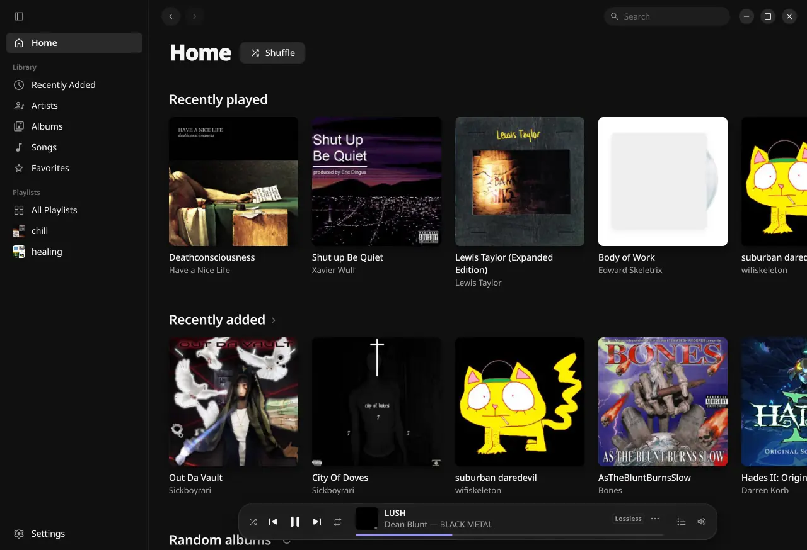

# Legato

A simple music player for Navidrome and other OpenSubsonic servers, with smooth mixing between songs.

[](https://github.com/eeegoloauq/legato/releases/latest)
[](https://github.com/eeegoloauq/legato/actions/workflows/ci.yml)
[](LICENSE)



## Install

Take the file for your system from the [latest release](https://github.com/eeegoloauq/legato/releases/latest).

    sudo dnf install ./legato-<version>-1.fc44.x86_64.rpm          # Fedora
    sudo pacman -U ./legato-<version>-1-x86_64.pkg.tar.zst         # Arch

On Windows, run `legato-<version>-windows-x86_64-setup.exe`. It installs for your account, without
administrator rights.

Elsewhere on Linux, install your distribution's libmpv and QtKeychain for Qt 6, unpack the tarball
and run `legato.sh`.

Legato asks for your server's address, username and password at the first start. With "Keep me
signed in" the password goes to the system keychain (GNOME Keyring, KWallet, KeePassXC, the Windows
Credential Manager).

## Features

- Albums, artists, songs, playlists and favorites from your server, with search (Ctrl+K)
- Automatic mixing between songs: it listens to the end of one and the start of the next, and albums still play without gaps
- Instant Mix from any artist, album or song
- Synced lyrics from the server, and from LRCLIB if you turn it on
- The queue is saved on the server and picked up at the next start, also from other Subsonic apps
- Media keys and the desktop's player controls (MPRIS)
- Several servers, one active at a time

## Development

Legato is Qt Quick and C++ with libmpv ([architecture](docs/architecture.md),
[design](docs/design.md), [roadmap](docs/roadmap.md)). It builds with the Qt from
`scripts/install-qt.sh`, CMake 3.22 or newer, Ninja, and the libmpv and QtKeychain development files
(Fedora: `sudo dnf install cmake ninja-build gcc-c++ mpv-libs-devel qtkeychain-qt6-devel`; Debian
and Ubuntu: `sudo apt install cmake ninja-build g++ libmpv-dev qtkeychain-qt6-dev`). The `dev` preset
also uses ccache and mold.

```sh
qt=$(scripts/install-qt.sh)                          # Qt 6.12.0 under ~/.cache/legato/qt
cmake --preset dev -DCMAKE_PREFIX_PATH="$qt"
cmake --build --preset dev                           # build/dev/bin/legato
ctest --test-dir build/dev                           # tests
cmake --build build/dev --target all_qmllint         # QML lint
```

`scripts/fake-subsonic.py` serves a generated library (user and password `test`).
`LEGATO_TEST_SERVER_URL`, `LEGATO_TEST_USERNAME` and `LEGATO_TEST_PASSWORD` use a server without
saving it:

```sh
scripts/fake-subsonic.py &
LEGATO_TEST_SERVER_URL=http://127.0.0.1:4533 LEGATO_TEST_USERNAME=test LEGATO_TEST_PASSWORD=test build/dev/bin/legato
```

`legato --help` lists the development options. Release packages come from the scripts in
`packaging/`; a `v*` tag builds and publishes them ([architecture](docs/architecture.md#packaging-and-releases)).

## License

[MIT](LICENSE)
